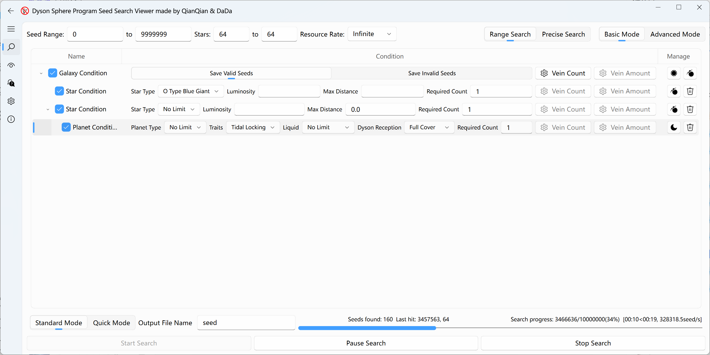
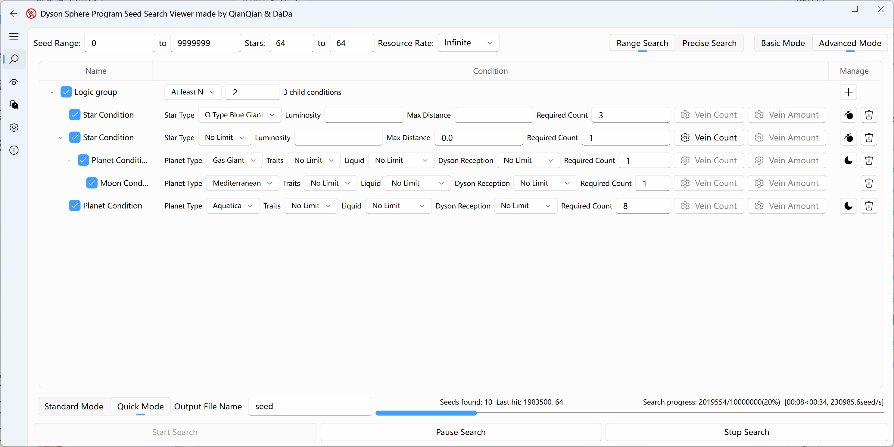
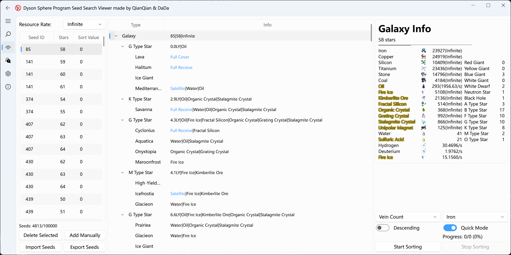

[English](./README_EN.md) | [简体中文](./README.md)

# Dyson Sphere Program Seed Searcher & Viewer

## Searcher Features

- Detailed search conditions: Basic Mode organizes conditions by galaxy, star, planet, and moon. Advanced Mode adds logic groups and bonds to combine requirements for veins, star/planet types, and distances between celestial bodies.
- High search efficiency: The seed search part is written in C++ for higher execution efficiency. The single-thread speed is more than 20 times that of [DspFindSeed](https://github.com/Xinyuell/DspFindSeed) (tested with the starter system Barren Desert condition).
- Built-in multi-threading: No need to open multiple instances.

Basic Mode:

Advanced Mode:

## Viewer Features

- Built-in UI to display seed info and export to files; allows manual or batch import of seed lists. The import format is compatible with [DspFindSeed](https://github.com/Xinyuell/DspFindSeed)'s search results.
- Supports seed sorting: Allows sorting seeds by star type, planet type, vein group/vein count, etc., and displays the corresponding sort value.
- Allows customized sort values: Ready-made interfaces are provided in [Custom Sort](/GUI/seed_viewer/sort_seed/custom_sort.py), making it convenient to write Python code to evaluate seed values for sorting.

## Usage Instructions

### General
- Standard Mode / Quick Mode: In Standard Mode, the tool ensures the calculated vein group/vein count is as consistent with the game as possible, representing the highest accuracy of this tool. However, fully generating veins has a huge performance overhead, hence the introduction of Quick Mode. In Quick Mode, the vein groups and veins used are theoretical maximums, and the actual generated count is about `0.8` times this value. Quick Mode has a similar performance overhead for each seed.

### Searcher
- Basic Mode: Conditions follow the galaxy, star, planet, and moon hierarchy. The galaxy can also contain planet conditions directly. Child conditions are combined with AND. Unchecking a condition disables only its own filter fields; its child conditions still apply. Unchecking the galaxy condition only disables galaxy mineral filters. Save Invalid Seeds inverts the final result of the entire set of conditions.
- Advanced Mode: Logic groups combine conditions using All, Any, At least N, or NOT, and can be nested. Galaxy mineral conditions and bond conditions can also be added. Unchecking a logic group, galaxy mineral condition, or bond condition makes that entire item count as passed, including toward the parent group's number of passing children. Star and planet checkboxes follow the same rules as Basic Mode.
- Switching Modes: Select Basic Mode or Advanced Mode at the top. Each saves its own conditions without automatic conversion; searches use the currently selected mode.
- Range Search / Precise Search: Range Search iterates over the configured seed ID and star count range. Precise Search performs a secondary search on an imported CSV file and automatically deduplicates the seeds. Both condition editing modes support these search ranges.
- Condition Optimization: Besides the Quick/Standard Mode setting, search conditions also significantly affect search speed. For specific reasons and related data, please refer to the in-app tutorial interface.
- Storage Format: Saves as `.csv` files. Each line represents one seed: `Seed ID, Star Count`, compatible with [DspFindSeed](https://github.com/Xinyuell/DspFindSeed).

For detailed instructions and examples, see the in-app tutorial or the [English tutorial](/assets/language/en_US/tutorial.md).

### Viewer
- Seed List: Maximum import limit is `100,000` seeds, with deduplication.
- Refresh Delay: Completely acquiring info for one seed takes about `1~3` seconds in CPU mode, and usually `<1` second with GPU acceleration enabled. The program caches info for the last `100` clicked seeds. You can quickly click multiple seeds to utilize multi-threading for accelerated generation.
- Seed Info Export: You can select seeds in the list, right-click, and batch export seed info. Each seed corresponds to a `.csv` file.
- Special Conditions: When sorting, high-yield gas giants are considered gas giants, but gas giants are not considered high-yield gas giants.

### Settings
#### Basic Settings
- Max CPU Threads: Can be set up to 128 threads, but the actual number of threads used will not exceed the CPU's logical processor count.
- GPU Acceleration: This program relies on OpenCL to accelerate planet terrain generation. Some GPUs may not support this. In this case, please disable this option, and the algorithm will fall back to CPU execution.
#### GPU Settings
- Work Group Size: Recommended to set to the maximum value supported by the GPU to improve performance. Since we cannot directly obtain whether the GPU supports this size, if normal searching/sorting fails, please try decreasing this value.
- GPU Device: Currently, the program only supports using at most one GPU. It is recommended to use the highest-performing GPU to improve performance.
- Max GPU Threads: Manages the maximum number of threads using GPU acceleration simultaneously. The optimal value can be found through performance testing.

## Supported Search Conditions
- Galaxy Level:
  - Minimum count of 14 vein types
  - Minimum yield of 14 vein types
- Star Level:
  - Star Type: Multi-select allowed
  - Minimum Luminosity
  - Maximum Distance: Input 0 for the starter star system
  - Match Count: Number of stars/star systems that need to meet the condition
  - Minimum count of 14 vein types: Unipolar Magnets only appear on Neutron Stars and Black Holes
  - Minimum yield of 14 vein types
- Planet Level:
  - Planet Type: Multi-select allowed. The starter planet is always and exclusively Mediterranean
  - Planet Features: i.e., planet attributes, multi-select allowed. The "Multiple Satellites" attribute only appears on gas planets (Gas Giants, Ice Giants, High-Yield Gas Giants), and satellite attributes will not appear on gas planets.
  - Liquid
  - Fully Enclosed: Global ray receivers can achieve 100% continuous reception without lenses (planet is entirely within the Dyson Sphere radius). A star system can have at most one such planet.
  - Full Reception: Global ray receivers can achieve 100% continuous reception with lenses (planet is inside the ionosphere radius constraint). A star system can have at most two such planets.
  - Match Count: Number of planets that need to meet the condition
  - Minimum count of 14 vein types
  - Minimum yield of 14 vein types
- Logic Group (Advanced Mode):
  - Supports All, Any, At least N, and NOT, with nested groups.
  - Groups cannot be empty. NOT requires exactly one child; N must be between 1 and the number of children.
- Bond Condition (Advanced Mode):
  - Each endpoint selects a star or planet condition to find pairs of celestial bodies within a specified distance.
  - Bond Count sets the minimum number of pairs; each endpoint's Max Connections limits the number of pairs per body.
  - Each pair is counted at most once, regardless of endpoint order. Planets use their host star's position to approximate distance.

## Special Thanks

The following repositories provided varying degrees of help during the development of this project, thanks!

- [dspseedsearch](https://github.com/crazyyao0/dspseedsearch)
- [DspFindSeed](https://github.com/Xinyuell/DspFindSeed)
- [PyQt-Fluent-Widgets](https://github.com/zhiyiYo/PyQt-Fluent-Widgets)
- [DSPSeedCalc](https://github.com/soarqin/DSPSeedCalc)
- [AhabAssistantLimbusCompany](https://github.com/KIYI671/AhabAssistantLimbusCompany)
