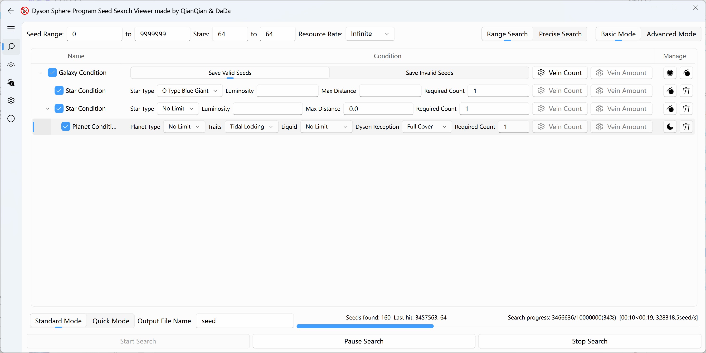
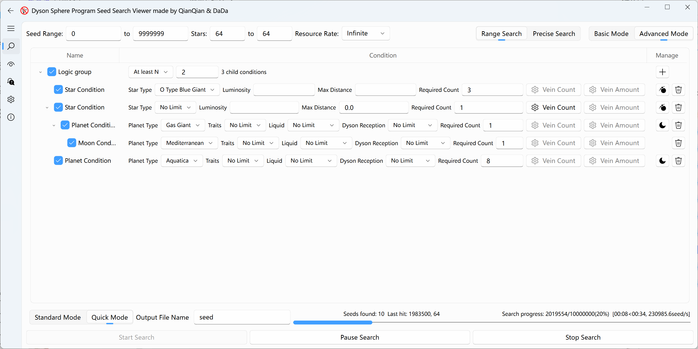
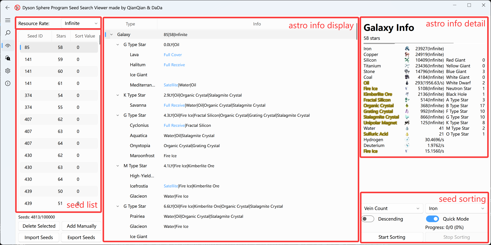
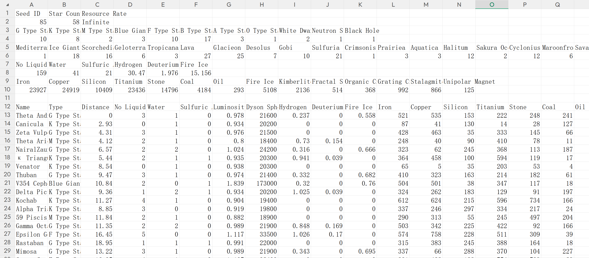
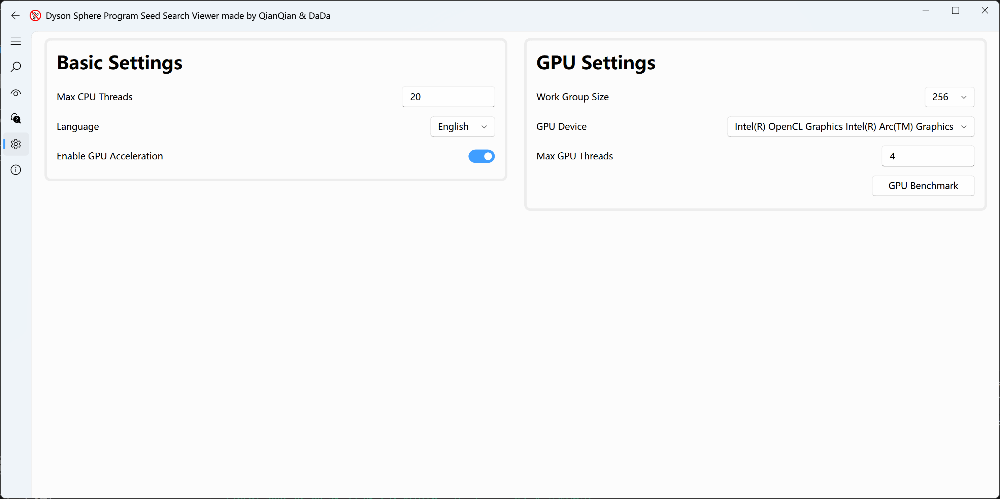

# Dyson Sphere Program Seed Searcher & Viewer Guide
In Dyson Sphere Program, each save's galaxy map is uniquely determined by the seed ID, star count, and resource rate. The resource rate only affects the amount in each vein; it does not affect vein locations or vein counts. Because resource distribution varies enormously between maps, the experience can range from a perfect starting system with a gas giant, two moons, and two rare resources to a cyber prison with only 30 unipolar magnets across the galaxy, no Aquatica, and no Sakura Ocean.

This is why seed searchers exist: they restore the galaxy-generation portion of the game's algorithm to find seeds that meet specific conditions. After multiple versions of updates, this seed searcher is currently the only known tool that perfectly reproduces both vein counts and vein amounts. It also includes built-in features for viewing and exporting seed information.

This project is fully open source. Stars are welcome.

Project repository: [dsp_search_seed](https://github.com/botany233/dsp_search_seed)

## Seed Search Tutorial
### UI
Click the magnifying-glass icon on the left to enter the seed search page. At the top, set the search range, star count, and resource rate, and switch between Range Search / Precise Search and Basic Mode / Advanced Mode. Edit search conditions in the middle. At the bottom, select search accuracy, set the output file name, and view search progress.

Basic Mode uses a fixed celestial hierarchy. Advanced Mode supports logic such as Any, At least N, and NOT, as well as distance requirements between celestial bodies. Each mode saves its own conditions. Switching modes does not convert conditions automatically; searches use the currently selected mode.

### Basic Mode
#### UI
Select Basic Mode at the top to edit galaxy, star, and planet conditions in a condition tree.



#### Search Condition Types
Each Dyson Sphere Program save is a galaxy. By celestial hierarchy, it can be divided into three levels, galaxy-star-planet, or four levels, galaxy-star-planet-moon.

Similarly, this program divides search conditions into three types: galaxy, star, and planet. A planet condition can add itself as a child condition, corresponding to the four-level celestial hierarchy. The supported search content and notes for the three condition types are listed below:

Galaxy conditions

- Minimum counts for 14 vein types
- Minimum amounts for 14 vein types

Star conditions

- Star type: multiple selection supported
- Minimum luminosity
- Max distance: enter 0 for the initial star system
- Required count: the number of star systems that must satisfy this condition
- Minimum counts for 14 vein types: unipolar magnets only appear around neutron stars and black holes
- Minimum amounts for 14 vein types

Planet conditions

- Planet type: multiple selection supported. Only the initial planet can be Mediterranean.
- Planet traits: also called planet entries; multiple selection supported
- Liquid type
- Dyson Reception: Full Cover, where the whole planet can receive without lenses; Full Receive, where the whole planet can receive with lenses. A galaxy can have at most one Full Cover Planet or two Full Receive Planets.
- Required count: the number of planets that must satisfy this condition
- Minimum counts for 14 vein types
- Minimum amounts for 14 vein types

#### Search Condition Structure
When searching seeds, the searcher starts from the galaxy condition and checks whether the current seed satisfies itself and all of its child conditions. When multiple child conditions exist, the searcher checks them one by one. Child conditions are independent of each other, so the same celestial body can satisfy multiple child conditions. The parent condition is considered satisfied only when all child conditions are satisfied, meaning child conditions are combined with an AND relationship.

The searcher also allows planet conditions to be added directly as child conditions of the galaxy. All possible condition structures are shown below:

```
Galaxy Condition
|-- Star Condition
|   |-- Planet Condition
|   `-- Planet Condition
|       `-- Moon Condition
|-- Planet Condition
`-- Planet Condition
    `-- Moon Condition
```

Use the buttons in the Manage column or the right-click menu to add and delete conditions. The galaxy condition is the fixed root and cannot be deleted. Adding a moon condition to a planet condition makes the parent condition filter planets with those moons.

The checkbox before a condition name enables or disables that condition's filter fields without changing its child conditions. Unchecking the galaxy condition only disables galaxy mineral filters; its star and planet child conditions still apply.

The galaxy condition row offers Save Valid Seeds and Save Invalid Seeds. The former saves seeds that satisfy the entire set of conditions. The latter inverts the final result and saves seeds that do not satisfy it. This inversion applies regardless of whether galaxy mineral filters are checked.

### Advanced Mode
#### UI
Select Advanced Mode at the top to organize search conditions using logic groups. Click the plus button in a logic group's Manage column or use its right-click menu to add a logic group, star condition, planet condition, galaxy mineral condition, or bond condition.



#### Logic Groups
Advanced Mode uses a logic group as its root. Each group combines its direct child conditions in one of the following ways:

- All: every child condition must pass.
- Any: at least one child condition must pass.
- At least N: at least N child conditions must pass. N must be between 1 and the number of children.
- NOT: requires exactly one child condition. The group passes when that child fails.

Logic groups can be nested. For example, to find seeds satisfying at least two of these three requirements—at least 3 Blue Giants, at least 2 Gas Giants with 3 moons each, and at least 6 Aquatica planets—create an At least N group, set N to 2, and add the three conditions separately.

A logic group cannot be empty. Invalid structures display a warning and must be corrected before searching. Unchecking a logic group makes the entire group count as passed; its internal conditions are no longer evaluated.

#### Celestial Conditions and Galaxy Mineral Conditions
Star and planet conditions use the same filter fields as Basic Mode. Stars can still contain planet conditions, and planets can still contain moon conditions. Planet conditions directly under a logic group search the entire galaxy; planet conditions under a star only search that star system.

A Galaxy mineral condition sets minimum counts and amounts for the galaxy's 14 vein types and can be combined with other conditions in a logic group. Unchecking it makes it count as passed. In Any and At least N groups, unchecked items that count as passed still contribute to the number of passing children.

#### Bond Conditions
A bond condition checks whether the seed contains enough pairs of celestial bodies within the required distance. Endpoint A and Endpoint B can each use a star or planet condition to select two groups of bodies. Max Distance limits the distance between the bodies in a pair; Bond Count sets the minimum number of pairs required.

Each endpoint's Max Connections limits how many bodies on the other side a single body can pair with. Each pair is counted at most once, endpoint order does not affect the result, and the same object can match both endpoints. Planets use their host star's position as an approximation.

For example, to find a Unipolar Magnet planet near a particular type of star, set Endpoint A to the desired star condition and Endpoint B to a planet condition requiring Unipolar Magnets. Then set Max Distance, Bond Count, and Max Connections for each endpoint.

Unchecking a bond condition makes the entire condition count as passed.

### Settings Shared by Both Modes

#### Saving Search Results
Results are stored as `.csv` files and can be viewed with Excel or WPS. Each row is a seed, including seed ID and star count but not resource rate, and is compatible with [DspFindSeed](https://github.com/Xinyuell/DspFindSeed). The file name can be configured at the bottom. The save location is the program's root directory.

#### Range Search / Precise Search
Range Search mode determines the search range by setting the starting seed ID, ending seed ID, and star count. Precise Search performs a secondary search on an imported, previously saved `.csv` seed list and includes deduplication.

Use Range Search / Precise Search at the top to switch between these search ranges. Both Basic Mode and Advanced Mode support them.

#### Standard Mode / Quick Mode
In Standard Mode, the calculated vein counts and amounts are kept as consistent with the game as possible, representing this program's highest accuracy. However, fully generating veins has a substantial performance cost, so Quick Mode is introduced. In Quick Mode, the calculated vein counts and amounts are theoretical maximum values. The actual vein count averages 78% of that value, and the actual vein amount averages 72% of that value. Quick Mode has roughly consistent performance cost for each seed, while Standard Mode varies greatly.

Use Standard Mode / Quick Mode at the bottom to switch search accuracy. Both Basic Mode and Advanced Mode support these accuracy settings.

## Seed Viewer Tutorial
### UI
Click the eye icon on the left to enter the seed viewer page. This page is mainly divided into five sections: resource rate selection, seed list, celestial information display, celestial information details, and seed sorting.


### Resource Rate Selection
This setting affects the resource rate used for generating seed information and sorting seeds in the viewer.

### Seed List
The viewer itself was not designed for extremely large seed volumes, so it has a limit of 100,000 seeds. Click any seed to switch the content shown in the celestial information display. Hold the left mouse button and drag to select multiple seeds for batch deletion or seed information export. Press Ctrl + A to select all seeds.

Depending on the number of threads, fully obtaining one seed's information with the CPU takes about 1 to 3 seconds. After enabling GPU acceleration, it usually takes less than 1 second. The program caches information for the 100 most recently clicked seeds.

In addition to seed ID and star count, a sort value is provided to evaluate seed value. When exporting a seed list, the sort value is exported as well.

### Celestial Information Display & Details
Click any celestial body in the celestial information display to view its details. Note that after switching the resource rate, the UI will not refresh automatically; you need to click again.

### Seed Sorting
The viewer includes four common seed sorting methods: Vein Count, Vein Amount, Planet Type, and Star Type. It also supports customization with Python code. See [README.md](../README.md) for the detailed tutorial.

The first button switches between ascending and descending sort order. The second button switches between Quick Mode and Standard Mode. Unlike the searcher, the viewer's Standard Mode is not performance-optimized. Sorting requires fully generating all information for every seed. On CPU, it is about 3,000 times slower than Quick Mode, so use it carefully.

Note that High-Yield Gas Giants are treated as Gas Giants when sorting by planet type.

### Exporting Seed Information
After selecting one or more seeds in the seed list, right-click and choose to export seed information. After confirming the content to export, click the export button below and choose an export folder. Each seed generates one **.csv** file, so when exporting many seeds, it is recommended to create a new folder<s> unless you want your desktop buried in files</s>.


## Settings Tutorial
### UI
Click the gear icon on the left to enter the settings page. This page is divided into two sections: Basic Settings and GPU Settings.


### Basic Settings
Max CPU Threads: controls the maximum number of threads that the searcher and viewer can create at the same time. It can be set up to 128 threads, but the number of threads actually used will not exceed the CPU's logical processor count. The default value is the same as the CPU's logical processor count. Note that with this setting, the UI may freeze during search and sorting. If you care about UI smoothness, reduce this value by 1.

Enable GPU Acceleration: the viewer must generate planet terrain when calculating buildable areas. This process is extremely time-consuming, but GPU acceleration can be used. After enabling it, the delay when refreshing seed information and the time required for sorting in the viewer can be significantly reduced. This program's GPU acceleration depends on OpenCL 3.0, and some ancient GPUs may not support it. Some GPUs do not support double precision, mainly Intel integrated graphics before the Ultra series. In that case, single precision will be used for calculation, but the generated mineral information will differ slightly from double precision. About 10% of seeds will have anomalies on 1 to 2 planets.

### GPU Settings
Work Group Size: this value has a negligible effect on GPU acceleration performance. Different GPUs support different maximum values. If search or sorting does not work properly, try reducing this value.

GPU Device: currently, the application only supports using at most one GPU. It is recommended to use the highest-performance GPU to improve performance.

Max GPU Threads: manages the maximum number of threads that use GPU acceleration at the same time. You can find the best value through performance testing. A value from 4 to 8 is recommended for integrated GPUs. Dedicated GPU performance varies significantly, so try a value from 8 to 16.

GPU Benchmark: tests how different GPU thread counts affect terrain generation speed under the specified CPU thread count. The default test time for each thread is 1 second, and it can be adjusted as needed.

## Searcher Performance
The searcher no longer uses GPU computation. The performance table is shown below. All results are for 64-star galaxies:

<table style="width:100%; border-collapse: collapse;">
  <tr class="table-header">
    <th style="border: 1px solid #ddd; padding: 10px; text-align: center;">Performance Table (seed/s)</th>
    <th style="border: 1px solid #ddd; padding: 10px; text-align: center;">Level 1</th>
    <th style="border: 1px solid #ddd; padding: 10px; text-align: center;">Level 2</th>
    <th style="border: 1px solid #ddd; padding: 10px; text-align: center;">Level 3 - Quick</th>
    <th style="border: 1px solid #ddd; padding: 10px; text-align: center;">Level 3 - Standard</th>
    <th style="border: 1px solid #ddd; padding: 10px; text-align: center;">Level 4 - Standard</th>
    <th style="border: 1px solid #ddd; padding: 10px; text-align: center;">Better Starting System - Standard</th>
    <th style="border: 1px solid #ddd; padding: 10px; text-align: center;">All Rares Hard Flight - Standard</th>
    <th style="border: 1px solid #ddd; padding: 10px; text-align: center;">All Rares Magnet - Standard</th>
  </tr>
  <tr>
    <td style="border: 1px solid #ddd; padding: 10px; text-align: center;">CPU(Ultra 7 155H)</td>
    <td style="border: 1px solid #ddd; padding: 10px; text-align: center;">322792</td>
    <td style="border: 1px solid #ddd; padding: 10px; text-align: center;">92074</td>
    <td style="border: 1px solid #ddd; padding: 10px; text-align: center;">62055</td>
    <td style="border: 1px solid #ddd; padding: 10px; text-align: center;">35356</td>
    <td style="border: 1px solid #ddd; padding: 10px; text-align: center;">154.44</td>
    <td style="border: 1px solid #ddd; padding: 10px; text-align: center;">245016</td>
    <td style="border: 1px solid #ddd; padding: 10px; text-align: center;">135186</td>
    <td style="border: 1px solid #ddd; padding: 10px; text-align: center;">64385</td>
  </tr>
</table>

- Level 1: at least 3 Blue Giants (B Type or O Type), with fewer than 2 B Type Blue Giants
- Level 2: at least two of the following three conditions: at least 6 Aquatica planets; at least 2 Gas Giants with at least 3 satellites each; at least 3 Blue Giants (B Type or O Type)
- Level 3: Oil x250 + Unipolar Magnet veins x250
- Level 4: Iron veins x30000
- Better Starting System: the initial star system has a Gas Giant, one of its satellites is Mediterranean, and another satellite is Desolus with Stalagmite Crystal and Fire Ice
- All Rares Hard Flight: galaxy Unipolar Magnet veins x80 + Stalagmite Crystal veins x400; within max distance 5, an O Type Star system has a Gas Giant, Tidal Locking, a Full Cover Planet, Water and Sulfuric Acid, and all rare resources except Unipolar Magnet
- All Rares Magnet: galaxy Unipolar Magnet veins x120; an O Type Star system has a High-Yield Gas Giant, a Full Receive Planet, Water and Sulfuric Acid, and all rare resources except Unipolar Magnet, while the nearest Unipolar Magnet planet is within 12 light-years

## Viewer Performance
The viewer sorting performance table is shown below. All results are for 64-star galaxies. Seed information export speed is similar to Custom - Standard Mode:

<table style="width:100%; border-collapse: collapse;">
  <tr class="table-header">
    <th style="border: 1px solid #ddd; padding: 10px; text-align: center;">Performance Table (seed/s)</th>
    <th style="border: 1px solid #ddd; padding: 10px; text-align: center;">Star Type</th>
    <th style="border: 1px solid #ddd; padding: 10px; text-align: center;">Planet Type</th>
    <th style="border: 1px solid #ddd; padding: 10px; text-align: center;">Minerals - Quick Mode</th>
    <th style="border: 1px solid #ddd; padding: 10px; text-align: center;">Minerals - Standard Mode</th>
    <th style="border: 1px solid #ddd; padding: 10px; text-align: center;">Custom - Quick Mode</th>
    <th style="border: 1px solid #ddd; padding: 10px; text-align: center;">Custom - Standard Mode</th>
  </tr>
  <tr>
    <td style="border: 1px solid #ddd; padding: 10px; text-align: center;">CPU(Ultra 7 155H)</td>
    <td rowspan="3" style="border: 1px solid #ddd; padding: 10px; text-align: center; vertical-align: middle;">49466</td>
    <td rowspan="3" style="border: 1px solid #ddd; padding: 10px; text-align: center; vertical-align: middle;">44662</td>
    <td rowspan="3" style="border: 1px solid #ddd; padding: 10px; text-align: center; vertical-align: middle;">35478~43840</td>
    <td rowspan="3" style="border: 1px solid #ddd; padding: 10px; text-align: center; vertical-align: middle;">96.06~7432</td>
    <td rowspan="3" style="border: 1px solid #ddd; padding: 10px; text-align: center; vertical-align: middle;">6020</td>
    <td style="border: 1px solid #ddd; padding: 10px; text-align: center;">6.29</td>
  </tr>
  <tr class="zebra-row">
    <td style="border: 1px solid #ddd; padding: 10px; text-align: center;">Integrated GPU (Arc 128EU)</td>
    <td style="border: 1px solid #ddd; padding: 10px; text-align: center;">9.42</td>
  </tr>
  <tr>
    <td style="border: 1px solid #ddd; padding: 10px; text-align: center;">Dedicated GPU (RX 9070)</td>
    <td style="border: 1px solid #ddd; padding: 10px; text-align: center;">30.20</td>
  </tr>
</table>
